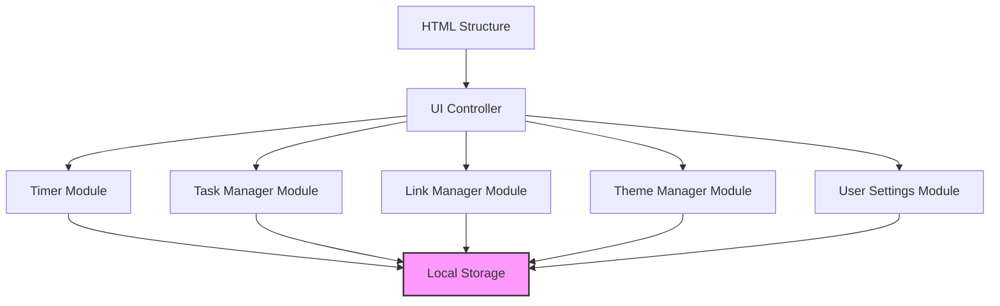
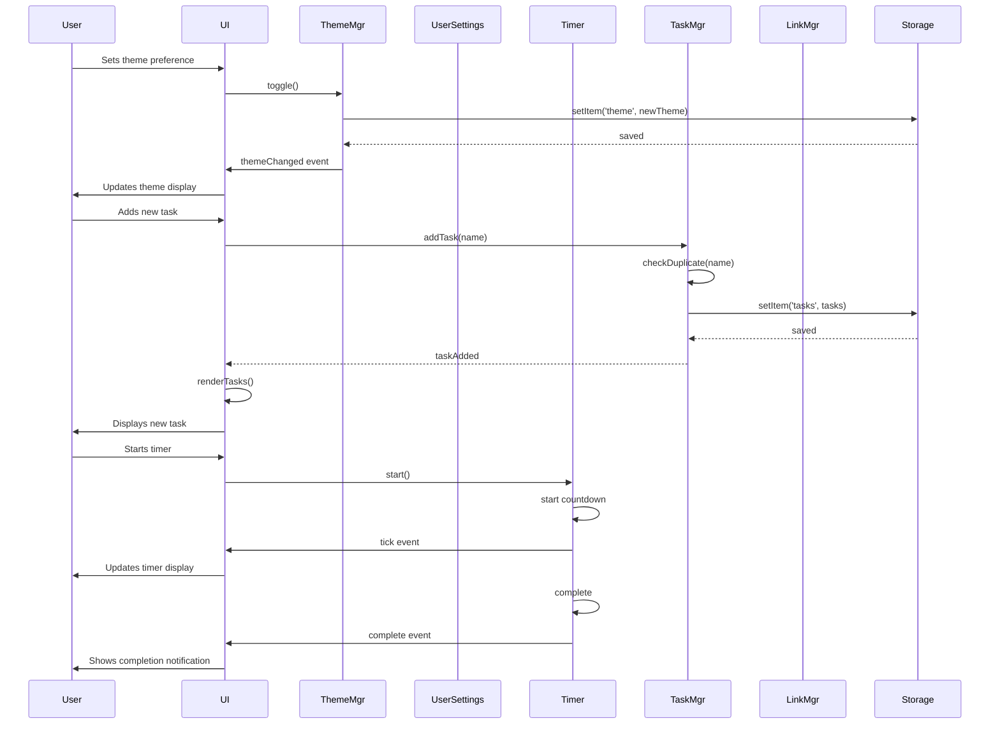
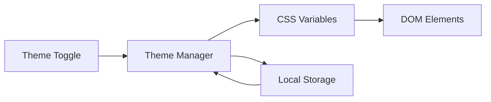
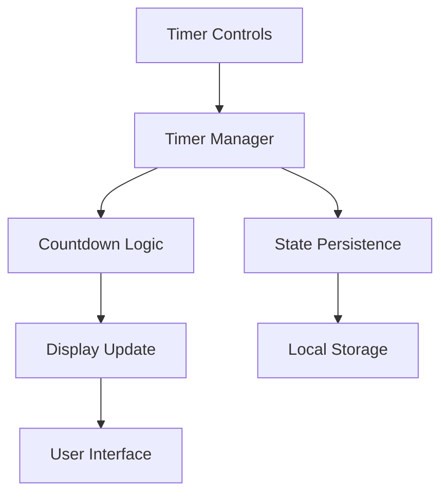
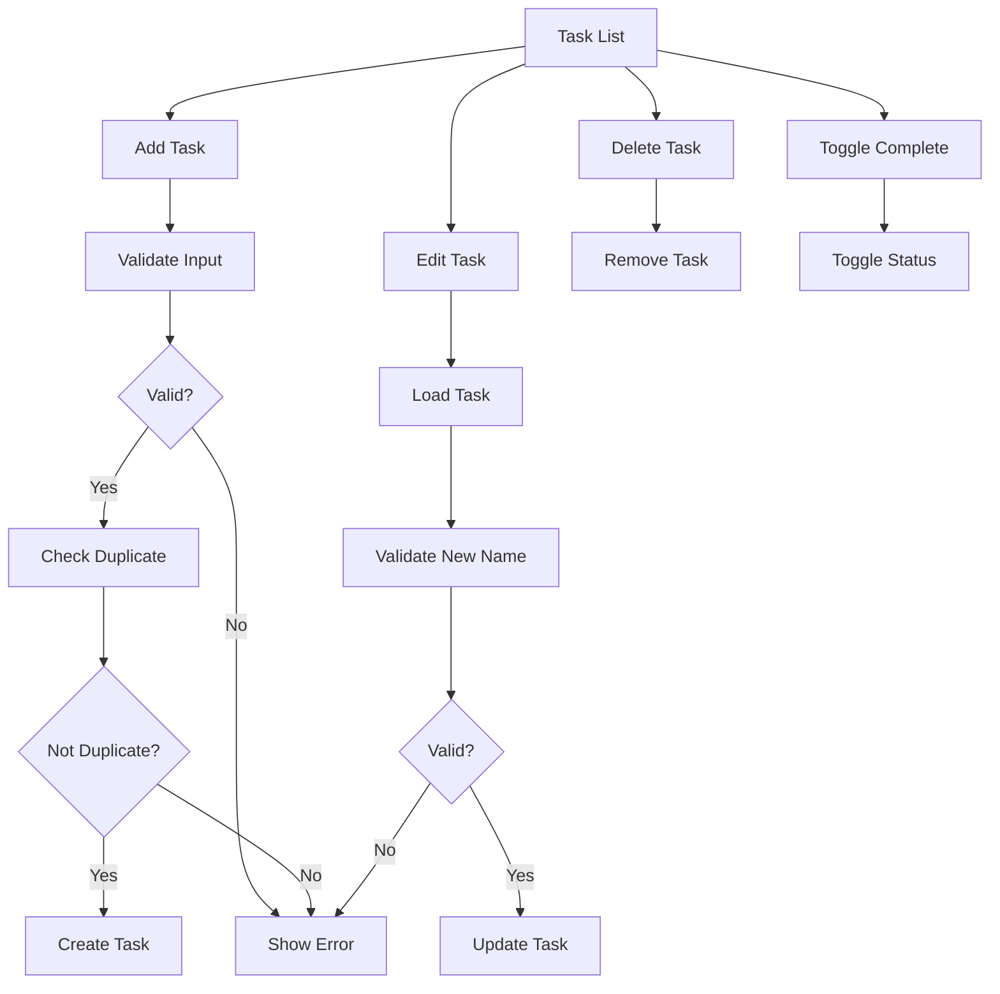
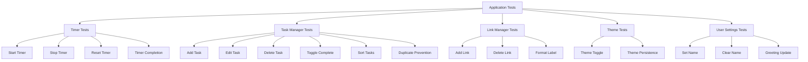

# Design Document: Pomodoro Timer Web Application

## Overview

This document presents the technical design for a Pomodoro timer web application. The application implements the Pomodoro Technique for time management, combining a customizable countdown timer with to-do list functionality and quick links to favorite websites.

The application is built using HTML, CSS, and vanilla JavaScript with no external frameworks. All data persists in the browser's Local Storage, ensuring user data remains available across sessions.

**Key Design Principles:**
- **Simplicity**: Minimal, distraction-free interface
- **Persistence**: All data stored in Local Storage
- **Customization**: Configurable timer duration and user preferences
- **Clean Architecture**: Modular, well-organized code structure

## Components and Interfaces

### UI Components

```
┌────────────────────────────────────────────────────────────┐
│                    Greeting Section                        │
│  • Personalized greeting with time/date                    │
│  • User name display                                       │
│  • Time of day adjustment                                  │
│  • Auto-updating clock (every 60 seconds)                  │
└────────────────────────────────────────────────────────────┘

┌────────────────────────────────────────────────────────────┐
│                    Theme Toggle                            │
│  • Light/Dark mode switch                                  │
│  • Visual theme indicator                                  │
│  • Persists preference to Local Storage                    │
└────────────────────────────────────────────────────────────┘

┌────────────────────────────────────────────────────────────┐
│                    Timer Section                           │
│  • Timer display (MM:SS format)                            │
│  • Duration configuration input                            │
│  • Start, Stop, Reset buttons                              │
│  • Completion notification                                 │
└────────────────────────────────────────────────────────────┘

┌────────────────────────────────────────────────────────────┐
│                   User Settings                            │
│  • Name input field                                        │
│  • Save name button                                        │
│  • Persists user preference                                │
└────────────────────────────────────────────────────────────┘

┌────────────────────────────────────────────────────────────┐
│                    To-Do List                              │
│  • Task input with add button                              │
│  • Task list with checkboxes                               │
│  • Edit and delete controls per task                       │
│  • Sort controls (date, completion)                        │
│  • Duplicate prevention                                    │
└────────────────────────────────────────────────────────────┘

┌────────────────────────────────────────────────────────────┐
│                   Quick Links                              │
│  • URL and label input fields                              │
│  • Add link button                                         │
│  • Link list with clickable URLs                           │
│  • Delete link per item                                    │
│  • Open links in new tab                                   │
└────────────────────────────────────────────────────────────┘
```

### Module Interfaces

```
┌────────────────────────────────────────────────────────────┐
│                    Module Interfaces                       │
├────────────────────────────────────────────────────────────┤
│                                                            │
│  ThemeManager                                              │
│  • init(): void                                            │
│  • toggle(): void                                          │
│  • apply(theme: string): void                              │
│  • on(event: 'change', callback: (theme: string) => void)│
│                                                            │
│  UserSettings                                              │
│  • init(): void                                            │
│  • setName(name: string): void                             │
│  • getName(): string | null                                │
│  • clearName(): void                                       │
│                                                            │
│  Timer                                                     │
│  • init(): void                                            │
│  • start(): void                                           │
│  • stop(): void                                            │
│  • reset(): void                                           │
│  • updateDuration(minutes: number): void                   │
│  • on(event: 'start'|'stop'|'tick'|'complete', cb)       │
│                                                            │
│  TaskManager                                               │
│  • init(): void                                            │
│  • addTask(name: string): void                             │
│  • editTask(id: string, newName: string): void             │
│  • deleteTask(id: string): void                            │
│  • toggleComplete(id: string): void                        │
│  • sortTasks(criterion: string): void                      │
│  • getTasks(): Task[]                                      │
│  • on(event: 'add'|'edit'|'delete'|'complete', cb)       │
│                                                            │
│  LinkManager                                               │
│  • init(): void                                            │
│  • addLink(url: string, label: string): void               │
│  • deleteLink(id: string): void                            │
│  • getLinks(): Link[]                                      │
│  • on(event: 'add'|'delete', callback)                    │
│                                                            │
└────────────────────────────────────────────────────────────┘
```

## Architecture

The application follows a module-based architecture with clear separation of concerns:



### Component Structure

```
pomodoro-timer-app/
├── index.html              # Main HTML structure
├── css/
│   └── styles.css          # All CSS rules
├── js/
│   └── app.js              # All JavaScript modules
└── assets/
    └── (optional images)
```

### Module Responsibilities

```
┌─────────────────────────────────────────────────────────┐
│                   UI Controller                         │
│  - Coordinates between modules                          │
│  - Handles DOM events                                   │
│  - Updates display elements                             │
└──────────────┬──────────────────────────────────────────┘
               │
    ┌──────────┴──────────┬───────────────┬───────────────┐
    │                     │               │               │
┌───v───┐            ┌────v───┐      ┌────v────┐     ┌────v────┐
│ Timer │            │  Task  │      │  Link   │     │  Theme  │
│Module │            │ Manager│      │ Manager │     │ Manager │
└───────┘            └────────┘      └─────────┘     └─────────┘
    │                     │               │               │
    │                     │               │               │
┌───v───┐            ┌────v───┐      ┌────v────┐     ┌────v────┐
│  User │            │  Local │      │  Local  │     │  Local  │
│Settings│            │Storage │      │ Storage │     │ Storage │
└───────┘            └────────┘      └─────────┘     └─────────┘
```

## Data Models

All data is stored in Local Storage as JSON strings. The data model consists of:

### 1. Timer Configuration

```javascript
{
  "timer": {
    "duration": 25,  // minutes, default 25
    "isRunning": false,
    "timeRemaining": 1500,  // seconds (25 minutes)
    "workInterval": 1500,   // seconds
    "breakInterval": 300    // seconds (5 minutes)
  }
}
```

### 2. Task List

```javascript
{
  "tasks": [
    {
      "id": "unique-id-123",
      "name": "Task description",
      "completed": false,
      "createdAt": "2024-01-15T10:30:00Z",
      "sortOrder": 0
    }
  ],
  "sortOrder": "date-desc"  // date-desc, date-asc, completed-first
}
```

### 3. Quick Links

```javascript
{
  "links": [
    {
      "id": "unique-id-456",
      "url": "https://example.com",
      "label": "Example Site",
      "createdAt": "2024-01-15T10:30:00Z"
    }
  ]
}
```

### 4. User Settings

```javascript
{
  "user": {
    "name": "John Doe",  // Optional
    "theme": "light"     // "light" or "dark"
  }
}
```

### 5. Storage Schema Summary

```
Local Storage Keys:
├── pomodoro_timer_config     → Timer configuration
├── pomodoro_tasks            → Task list
├── pomodoro_links            → Quick links
└── pomodoro_user             → User settings
```

## File Structure

### Directory Layout

```
project-root/
├── index.html              # Main HTML file with all sections
├── css/
│   └── styles.css          # Complete CSS styling
├── js/
│   └── app.js              # All JavaScript modules
└── README.md               # Project documentation
```

### HTML Structure

```html
<!DOCTYPE html>
<html lang="en">
<head>
    <meta charset="UTF-8">
    <meta name="viewport" content="width=device-width, initial-scale=1.0">
    <title>Pomodoro Timer</title>
    <link rel="stylesheet" href="css/styles.css">
</head>
<body>
    <!-- Greeting Section -->
    <header class="greeting-section">
        <h1 id="greeting">Welcome back!</h1>
        <p id="datetime">January 15, 2024 • 10:30 AM</p>
    </header>

    <!-- Theme Toggle -->
    <button id="theme-toggle" aria-label="Toggle theme">
        🌓 <span id="theme-indicator">Light</span>
    </button>

    <!-- Timer Section -->
    <main class="timer-section">
        <h2>Focus Timer</h2>
        <div class="timer-controls">
            <label for="duration-input">Duration (minutes):</label>
            <input type="number" id="duration-input" min="1" max="120" value="25">
            <span id="timer-display">25:00</span>
        </div>
        <div class="timer-buttons">
            <button id="start-btn">Start</button>
            <button id="stop-btn">Stop</button>
            <button id="reset-btn">Reset</button>
        </div>
    </main>

    <!-- User Name Configuration -->
    <section class="user-settings">
        <h2>Your Name</h2>
        <input type="text" id="name-input" placeholder="Enter your name" maxlength="50">
        <button id="save-name-btn">Save Name</button>
    </section>

    <!-- To-Do List Section -->
    <section class="tasks-section">
        <h2>To-Do List</h2>
        <div class="task-input">
            <input type="text" id="task-input" placeholder="Add a new task..." maxlength="200">
            <button id="add-task-btn">Add Task</button>
        </div>
        <div class="task-controls">
            <button id="sort-date-btn">Sort by Date</button>
            <button id="sort-completed-btn">Sort by Status</button>
        </div>
        <ul id="task-list" class="task-list"></ul>
    </section>

    <!-- Quick Links Section -->
    <section class="links-section">
        <h2>Quick Links</h2>
        <div class="link-input">
            <input type="url" id="link-url" placeholder="https://example.com" required>
            <input type="text" id="link-label" placeholder="Label (optional)" maxlength="50">
            <button id="add-link-btn">Add Link</button>
        </div>
        <ul id="link-list" class="link-list"></ul>
    </section>

    <script src="js/app.js"></script>
</body>
</html>
```

## CSS Organization Strategy

### CSS Structure

The CSS file (`css/styles.css`) follows a BEM-like naming convention with clear section organization:

```css
/* 1. CSS Variables (Theme System) */
:root {
    /* Light theme variables */
    --bg-primary: #ffffff;
    --bg-secondary: #f5f5f5;
    --text-primary: #333333;
    --text-secondary: #666666;
    --accent-color: #4a90d9;
    --accent-hover: #357abd;
    --success-color: #4caf50;
    --error-color: #f44336;
    --border-color: #e0e0e0;
    --shadow: 0 2px 4px rgba(0,0,0,0.1);
}

/* Dark theme variables */
[data-theme="dark"] {
    --bg-primary: #1a1a2e;
    --bg-secondary: #16213e;
    --text-primary: #eaeaea;
    --text-secondary: #a0a0a0;
    --accent-color: #5a9de7;
    --accent-hover: #4a8dcb;
    --success-color: #66bb6a;
    --error-color: #e57373;
    --border-color: #333333;
    --shadow: 0 2px 4px rgba(0,0,0,0.3);
}

/* 2. Reset & Base Styles */
* {
    margin: 0;
    padding: 0;
    box-sizing: border-box;
}

body {
    font-family: -apple-system, BlinkMacSystemFont, 'Segoe UI', Roboto, Oxygen, Ubuntu, sans-serif;
    background-color: var(--bg-primary);
    color: var(--text-primary);
    line-height: 1.6;
    min-height: 100vh;
    transition: background-color 0.3s, color 0.3s;
}

/* 3. Layout Components */
.greeting-section {
    padding: 2rem;
    text-align: center;
}

.timer-section {
    padding: 2rem;
    text-align: center;
}

.tasks-section, .links-section {
    padding: 2rem;
    max-width: 600px;
    margin: 0 auto;
}

/* 4. Form Elements */
input[type="text"],
input[type="url"],
input[type="number"] {
    padding: 0.75rem;
    border: 1px solid var(--border-color);
    border-radius: 4px;
    background-color: var(--bg-secondary);
    color: var(--text-primary);
    transition: border-color 0.2s;
}

button {
    padding: 0.75rem 1.5rem;
    border: none;
    border-radius: 4px;
    background-color: var(--accent-color);
    color: white;
    cursor: pointer;
    transition: background-color 0.2s;
}

/* 5. Timer Styles */
.timer-display {
    font-size: 4rem;
    font-weight: bold;
    margin: 1rem 0;
    color: var(--accent-color);
}

/* Ensure timer display remains prominent while running (Requirement 15.4) */
[data-timer-running="true"] .timer-display {
    position: sticky;
    top: 0;
    z-index: 1000;
    font-size: 5rem;
    animation: pulse 1s ease-in-out infinite;
    background-color: var(--bg-primary);
    padding: 1rem;
    box-shadow: 0 4px 6px rgba(0,0,0,0.2);
}

@keyframes pulse {
    0%, 100% { opacity: 1; }
    50% { opacity: 0.8; }
}

/* 6. Task List Styles */
.task-item {
    display: flex;
    align-items: center;
    padding: 1rem;
    background-color: var(--bg-secondary);
    border-radius: 4px;
    margin-bottom: 0.5rem;
}

.task-item.completed {
    opacity: 0.7;
    text-decoration: line-through;
}

/* 7. Link List Styles */
.link-item {
    display: flex;
    align-items: center;
    padding: 0.75rem 1rem;
    background-color: var(--bg-secondary);
    border-radius: 4px;
    margin-bottom: 0.5rem;
}

.link-item a {
    color: var(--accent-color);
    text-decoration: none;
    flex: 1;
}

.link-item a:hover {
    text-decoration: underline;
}

/* 8. Utility Classes */
.hidden {
    display: none !important;
}

.error-message {
    color: var(--error-color);
    font-size: 0.875rem;
    margin-top: 0.5rem;
}

/* 9. Responsive Design */
@media (max-width: 600px) {
    .greeting-section,
    .timer-section,
    .tasks-section,
    .links-section {
        padding: 1rem;
    }
    
    .timer-display {
        font-size: 3rem;
    }
    
    /* Responsive prominence for mobile */
    [data-timer-running="true"] .timer-display {
        font-size: 4rem;
    }
}
```

### CSS Organization Order

1. **CSS Variables** - Theme colors and values
2. **Reset & Base Styles** - Global reset and base styles
3. **Layout Components** - Section positioning and sizing
4. **Form Elements** - Input and button styles
5. **Component Styles** - Specific element styles (timer, tasks, links)
6. **State Styles** - Active, completed, error states
7. **Utility Classes** - Helper classes for common patterns
8. **Responsive Design** - Media queries for different screen sizes

## JavaScript Module Organization

### Module Structure

```javascript
// app.js - Main application file with modular architecture

// 1. Utility Functions
const Utils = {
    generateId: () => /* generates unique IDs */,
    formatDate: (date) => /* formats date for display */,
    formatTime: (seconds) => /* converts seconds to MM:SS */,
    debounce: (fn, delay) => /* debounces function calls */
};

// 2. Local Storage Manager
const Storage = {
    getItem: (key) => /* retrieves and parses JSON */,
    setItem: (key, data) => /* converts to JSON and stores */,
    removeItem: (key) => /* removes item from storage */,
    clear: () => /* clears all app data */
};

// 3. Theme Manager
const ThemeManager = {
    themes: { light: 'light', dark: 'dark' },
    currentTheme: null,
    init: () => /* loads saved theme */,
    toggle: () => /* switches theme */,
    apply: (theme) => /* applies theme to document */
};

// 4. User Settings Manager
const UserSettings = {
    name: null,
    init: () => /* loads saved name */,
    setName: (name) => /* saves and displays name */,
    getName: () => /* returns saved name */,
    clearName: () => /* removes saved name */
};

// 5. Timer Manager
const Timer = {
    duration: 25,  // minutes
    timeRemaining: 1500,  // seconds
    intervalId: null,
    isRunning: false,
    
    init: () => /* loads saved timer state */,
    start: () => /* begins countdown */,
    stop: () => /* pauses countdown */,
    reset: () => /* resets to full duration */,
    tick: () => /* decrements timer and updates display */,
    complete: () => /* handles timer completion */,
    updateDuration: (minutes) => /* updates duration setting */
};

// 6. Task Manager
const TaskManager = {
    tasks: [],
    sortOrder: 'date-desc',
    
    init: () => /* loads tasks from storage */,
    addTask: (name) => /* adds new task with validation */,
    editTask: (id, newName) => /* edits existing task */,
    deleteTask: (id) => /* removes task */,
    toggleComplete: (id) => /* toggles completion status */,
    sortTasks: (criterion) => /* sorts task array */,
    getTasks: () => /* returns current task list */,
    checkDuplicate: (name) => /* checks for duplicate task names */
};

// 7. Link Manager
const LinkManager = {
    links: [],
    
    init: () => /* loads links from storage */,
    addLink: (url, label) => /* adds new link with validation */,
    deleteLink: (id) => /* removes link */,
    getLinks: () => /* returns current links */,
    formatLabel: (url, label) => /* generates display label */
};

// 8. UI Controller
const UI = {
    elements: {
        greeting: document.getElementById('greeting'),
        datetime: document.getElementById('datetime'),
        timerDisplay: document.getElementById('timer-display'),
        // ... all DOM elements
    },
    
    init: () => /* initializes event listeners and renders initial state */,
    updateGreeting: () => /* updates greeting based on time and user name */,
    updateDateTime: () => /* updates current date/time display */,
    renderTasks: () => /* renders task list to DOM */,
    renderLinks: () => /* renders quick links to DOM */,
    showError: (message) => /* displays error message */,
    hideError: () => /* hides error message */,
    ensureTimerProminence: (isRunning) => /* ensures timer remains prominent while running (Requirement 15.4) */,
    updateTaskEditDisplay: (taskId, newName) => /* updates task display to show duplicate name for correction */
};

// 9. Application Initialization
document.addEventListener('DOMContentLoaded', () => {
    // Initialize all modules
    ThemeManager.init();
    UserSettings.init();
    Timer.init();
    TaskManager.init();
    LinkManager.init();
    UI.init();
    
    // Start datetime updater
    UI.updateDateTime();
    setInterval(UI.updateDateTime, 60000);  // Update every 60 seconds
});
```

### Module Dependencies

```
┌─────────────────┐
│  Application    │
│  Initialization │
└────────┬────────┘
         │
    ┌────┴─────┬──────────┬──────────┬──────────┐
    │          │          │          │          │
    ▼          ▼          ▼          ▼          ▼
┌──────┐  ┌──────┐  ┌──────┐  ┌──────┐  ┌──────┐
│Theme │  │  User│  │ Timer│  │ Task │  │ Link │
│Mgr   │  │ Settings│  │      │  │Mgr   │  │Mgr   │
└──┬───┘  └──┬─────┘  └──┬───┘  └──┬───┘  └──┬───┘
   │         │           │         │         │
   └─────────┴───────────┴─────────┴─────────┘
                     │
                ┌────▼────┐
                │Storage  │
                │Manager  │
                └─────────┘
```

### Module Interaction Diagram



## State Management Approach

### State Management Strategy

The application uses a decentralized state management approach with each module maintaining its own state:

```javascript
// Global state structure
const AppState = {
    timer: {
        duration: 25,
        timeRemaining: 1500,
        isRunning: false,
        workInterval: 1500,
        breakInterval: 300
    },
    tasks: [],
    links: [],
    user: {
        name: null,
        theme: 'light'
    },
    ui: {
        error: null,
        sort: 'date-desc'
    }
};
```

### State Flow

```
┌─────────────────────────────────────────────────────────┐
│                   State Flow                            │
├─────────────────────────────────────────────────────────┤
│                                                         │
│   1. Load State (on init)                              │
│      Storage → Module State                            │
│                                                         │
│   2. User Action                                       │
│      UI → Module Method                                │
│                                                         │
│   3. Update State                                      │
│      Module → New State                                │
│                                                         │
│   4. Persist State                                     │
│      Module → Storage                                  │
│                                                         │
│   5. Update UI                                         │
│      UI → DOM Updates                                  │
│                                                         │
└─────────────────────────────────────────────────────────┘
```

### Local Storage Persistence

```javascript
// Persistence strategy: update on every change
const Storage = {
    persist: () => {
        // Update localStorage after every state change
        Storage.setItem('pomodoro_timer_config', Timer.getState());
        Storage.setItem('pomodoro_tasks', TaskManager.getState());
        Storage.setItem('pomodoro_links', LinkManager.getState());
        Storage.setItem('pomodoro_user', UserSettings.getState());
    }
};
```

## Event Handling Strategy

### Event System

The application uses DOM events with a clean separation between event handlers and business logic:

```javascript
// Event handling structure
const EventSystem = {
    handlers: {},
    
    on: (event, handler) => {
        if (!EventSystem.handlers[event]) {
            EventSystem.handlers[event] = [];
        }
        EventSystem.handlers[event].push(handler);
    },
    
    emit: (event, data) => {
        const handlers = EventSystem.handlers[event] || [];
        handlers.forEach(handler => handler(data));
    }
};

// Example: Timer ticks
Timer.on('tick', (timeRemaining) => {
    UI.updateTimerDisplay(timeRemaining);
});

Timer.on('complete', () => {
    UI.showCompletionNotification();
});

// DOM event delegation
document.addEventListener('click', (e) => {
    if (e.target.matches('#start-btn')) {
        Timer.start();
    } else if (e.target.matches('#stop-btn')) {
        Timer.stop();
    } else if (e.target.matches('#add-task-btn')) {
        TaskManager.addTask(UI.getTaskInput());
    }
    // ... other handlers
});
```

### Event Types

```
Event Categories:
├── Timer Events
│   ├── start
│   ├── stop
│   ├── reset
│   ├── tick
│   └── complete
│
├── Task Events
│   ├── add
│   ├── edit
│   ├── delete
│   ├── toggleComplete
│   └── sort
│
├── Link Events
│   ├── add
│   └── delete
│
└── System Events
    ├── themeChange
    ├── userSettingsUpdate
    └── stateChange
```

## Theme Implementation Approach

### Theme System Architecture



### Theme Implementation

```javascript
const ThemeManager = {
    themes: {
        light: {
            '--bg-primary': '#ffffff',
            '--bg-secondary': '#f5f5f5',
            '--text-primary': '#333333',
            '--text-secondary': '#666666',
            '--accent-color': '#4a90d9',
            '--accent-hover': '#357abd',
            '--success-color': '#4caf50',
            '--error-color': '#f44336',
            '--border-color': '#e0e0e0',
            '--shadow': '0 2px 4px rgba(0,0,0,0.1)'
        },
        dark: {
            '--bg-primary': '#1a1a2e',
            '--bg-secondary': '#16213e',
            '--text-primary': '#eaeaea',
            '--text-secondary': '#a0a0a0',
            '--accent-color': '#5a9de7',
            '--accent-hover': '#4a8dcb',
            '--success-color': '#66bb6a',
            '--error-color': '#e57373',
            '--border-color': '#333333',
            '--shadow': '0 2px 4px rgba(0,0,0,0.3)'
        }
    },
    
    init: function() {
        const savedTheme = Storage.getItem('pomodoro_theme') || 'light';
        this.apply(savedTheme);
    },
    
    toggle: function() {
        const newTheme = this.currentTheme === 'light' ? 'dark' : 'light';
        this.apply(newTheme);
    },
    
    apply: function(theme) {
        this.currentTheme = theme;
        
        // Apply CSS variables
        const root = document.documentElement;
        const colors = this.themes[theme];
        
        for (const [variable, value] of Object.entries(colors)) {
            root.style.setProperty(variable, value);
        }
        
        // Update data attribute for selectors
        document.documentElement.setAttribute('data-theme', theme);
        
        // Update theme indicator
        document.getElementById('theme-indicator').textContent = theme.charAt(0).toUpperCase() + theme.slice(1);
        
        // Persist to storage
        Storage.setItem('pomodoro_theme', theme);
    }
};
```

### Theme Toggle UI

```html
<button id="theme-toggle" aria-label="Toggle theme">
    🌓 <span id="theme-indicator">Light</span>
</button>
```

```javascript
document.getElementById('theme-toggle').addEventListener('click', () => {
    ThemeManager.toggle();
});
```

## Timer Implementation Approach

### Timer Architecture



### Timer Implementation

```javascript
const Timer = {
    duration: 25,  // in minutes
    timeRemaining: 1500,  // in seconds
    intervalId: null,
    isRunning: false,
    
    init: function() {
        const savedState = Storage.getItem('pomodoro_timer_config');
        if (savedState) {
            this.duration = savedState.duration || 25;
            this.timeRemaining = savedState.timeRemaining || this.duration * 60;
            this.isRunning = savedState.isRunning || false;
            
            // Restore interval if running
            if (this.isRunning) {
                this.start();
            }
        }
        UI.updateTimerDisplay(this.timeRemaining);
    },
    
    start: function() {
        if (this.isRunning) return;
        
        this.isRunning = true;
        this.saveState();
        
        this.intervalId = setInterval(() => {
            this.tick();
        }, 1000);
        
        UI.updateTimerControls(true);
        // Ensure Timer_Display remains prominent across all screens while timer runs
        UI.ensureTimerProminence(true);
    },
    
    stop: function() {
        if (!this.isRunning) return;
        
        this.isRunning = false;
        clearInterval(this.intervalId);
        this.saveState();
        
        UI.updateTimerControls(false);
        // Release prominence requirement when timer stops
        UI.ensureTimerProminence(false);
    },
    
    reset: function() {
        this.stop();
        this.timeRemaining = this.duration * 60;
        UI.updateTimerDisplay(this.timeRemaining);
        this.saveState();
    },
    
    tick: function() {
        this.timeRemaining--;
        UI.updateTimerDisplay(this.timeRemaining);
        
        if (this.timeRemaining <= 0) {
            this.complete();
        } else {
            this.saveState();
        }
    },
    
    complete: function() {
        this.stop();
        // Play notification sound
        const audio = new Audio('assets/sound.mp3');
        audio.play().catch(() => {
            // Audio play may fail without user interaction
            // Fallback: visual notification
        });
        
        // Show completion notification
        UI.showCompletionNotification();
        // Release prominence requirement when timer completes
        UI.ensureTimerProminence(false);
    },
    
    updateDuration: function(minutes) {
        const newDuration = parseInt(minutes, 10);
        if (newDuration < 1 || newDuration > 120) return;
        
        this.duration = newDuration;
        if (!this.isRunning) {
            this.timeRemaining = newDuration * 60;
            UI.updateTimerDisplay(this.timeRemaining);
        }
        // Save new duration to Local Storage immediately but do not affect current countdown
        // The new value will be applied on next Reset
        this.saveState();
    },
    
    saveState: function() {
        Storage.setItem('pomodoro_timer_config', {
            duration: this.duration,
            timeRemaining: this.timeRemaining,
            isRunning: this.isRunning,
            workInterval: this.duration * 60,
            breakInterval: 300  // Fixed 5-minute break
        });
    },
    
    getState: function() {
        return {
            duration: this.duration,
            timeRemaining: this.timeRemaining,
            isRunning: this.isRunning,
            workInterval: this.duration * 60,
            breakInterval: 300
        };
    }
};
```

### Timer Display Prominence

Requirement 15.4 specifies that the Timer_Display must remain prominent across all screens while the timer runs. This is implemented through the UI controller's `ensureTimerProminence` method:

```javascript
UI.ensureTimerProminence = function(isRunning) {
    const timerDisplay = document.getElementById('timer-display');
    
    if (isRunning) {
        // Apply CSS class to ensure timer remains prominent
        timerDisplay.classList.add('timer-prominent');
        // Set data attribute for CSS selectors
        document.documentElement.setAttribute('data-timer-running', 'true');
    } else {
        // Remove prominence styling when timer stops
        timerDisplay.classList.remove('timer-prominent');
        document.documentElement.removeAttribute('data-timer-running');
    }
};
```

The corresponding CSS uses a data attribute to ensure prominence:

```css
/* Ensure timer display remains prominent while running */
[data-timer-running="true"] .timer-display {
    position: sticky;
    top: 0;
    z-index: 1000;
    font-size: 5rem;
    animation: pulse 1s ease-in-out infinite;
    background-color: var(--bg-primary);
    padding: 1rem;
    box-shadow: 0 4px 6px rgba(0,0,0,0.2);
}

@keyframes pulse {
    0%, 100% { opacity: 1; }
    50% { opacity: 0.8; }
}

/* Responsive prominence for mobile */
@media (max-width: 600px) {
    [data-timer-running="true"] .timer-display {
        font-size: 4rem;
    }
}
```

### Timer Display Format

```javascript
// Format: MM:SS
Timer.formatTime = function(seconds) {
    const minutes = Math.floor(seconds / 60);
    const remainingSeconds = seconds % 60;
    
    return `${minutes.toString().padStart(2, '0')}:${remainingSeconds.toString().padStart(2, '0')}`;
};
```

## Task Management Logic

### Task Data Structure

```javascript
{
  "id": "task-uuid-123",
  "name": "Complete project documentation",
  "completed": false,
  "createdAt": "2024-01-15T10:30:00Z",
  "sortOrder": 0
}
```

### Task Manager Implementation

```javascript
const TaskManager = {
    tasks: [],
    sortOrder: 'date-desc',
    
    init: function() {
        const savedData = Storage.getItem('pomodoro_tasks');
        if (savedData) {
            this.tasks = savedData.tasks || [];
            this.sortOrder = savedData.sortOrder || 'date-desc';
        }
        UI.renderTasks();
    },
    
    addTask: function(name) {
        const trimmedName = name.trim();
        
        // Validation
        if (!trimmedName) {
            UI.showError('Task name cannot be empty');
            return;
        }
        
        if (this.checkDuplicate(trimmedName)) {
            UI.showError('Task already exists');
            return;
        }
        
        const newTask = {
            id: Utils.generateId(),
            name: trimmedName,
            completed: false,
            createdAt: new Date().toISOString(),
            sortOrder: this.tasks.length
        };
        
        this.tasks.push(newTask);
        this.applySort();
        this.save();
        UI.renderTasks();
        UI.hideError();
    },
    
    editTask: function(id, newName) {
        const trimmedName = newName.trim();
        const task = this.tasks.find(t => t.id === id);
        
        if (!task) return;
        
        if (!trimmedName) {
            UI.showError('Task name cannot be empty');
            // Keep task in editing mode with the original name displayed
            return;
        }
        
        if (this.checkDuplicate(trimmedName, id)) {
            // Keep task in editing mode with the duplicate name displayed for user correction
            UI.showError('Task already exists');
            // Update the display to show the duplicate name for user correction
            UI.updateTaskEditDisplay(id, trimmedName);
            return;
        }
        
        task.name = trimmedName;
        this.save();
        UI.renderTasks();
        UI.hideError();
    },
    
    deleteTask: function(id) {
        this.tasks = this.tasks.filter(t => t.id !== id);
        this.reassignSortOrder();
        this.save();
        UI.renderTasks();
    },
    
    bulkDeleteTasks: function(ids) {
        // Atomic deletion: all tasks deleted together or none if any fails
        try {
            // Validate all IDs exist first
            const existingTasks = ids.map(id => {
                const task = this.tasks.find(t => t.id === id);
                if (!task) {
                    throw new Error(`Task with ID ${id} not found`);
                }
                return task;
            });
            
            // If all validations pass, proceed with deletion
            this.tasks = this.tasks.filter(t => !ids.includes(t.id));
            this.reassignSortOrder();
            this.save();
            UI.renderTasks();
        } catch (error) {
            UI.showError('Failed to delete tasks: ' + error.message);
            // No tasks were deleted due to atomic requirement
        }
    },
    
    toggleComplete: function(id) {
        const task = this.tasks.find(t => t.id === id);
        if (task) {
            task.completed = !task.completed;
            this.save();
            UI.renderTasks();
        }
    },
    
    sortTasks: function(criterion) {
        this.sortOrder = criterion;
        
        switch (criterion) {
            case 'date-desc':
                this.tasks.sort((a, b) => new Date(b.createdAt) - new Date(a.createdAt));
                break;
            case 'date-asc':
                this.tasks.sort((a, b) => new Date(a.createdAt) - new Date(b.createdAt));
                break;
            case 'completed-first':
                // Sort completed tasks at bottom, but retain existing date-sort order as secondary key
                this.tasks.sort((a, b) => {
                    if (a.completed === b.completed) {
                        // Same completion status, sort by date (newest first as default)
                        return new Date(b.createdAt) - new Date(a.createdAt);
                    }
                    return a.completed ? 1 : -1;
                });
                break;
        }
        
        this.reassignSortOrder();
        this.save();
        UI.renderTasks();
    },
    
    checkDuplicate: function(name, excludeId = null) {
        return this.tasks.some(task => 
            task.name.toLowerCase() === name.toLowerCase() && 
            task.id !== excludeId
        );
    },
    
    applySort: function() {
        this.sortTasks(this.sortOrder);
    },
    
    reassignSortOrder: function() {
        this.tasks.forEach((task, index) => {
            task.sortOrder = index;
        });
    },
    
    save: function() {
        Storage.setItem('pomodoro_tasks', {
            tasks: this.tasks,
            sortOrder: this.sortOrder
        });
    },
    
    getState: function() {
        return {
            tasks: this.tasks,
            sortOrder: this.sortOrder
        };
    },
    
    getTasks: function() {
        return this.tasks;
    }
};
```

### Task CRUD Operations



## Quick Links Management Logic

### Link Data Structure

```javascript
{
  "id": "link-uuid-456",
  "url": "https://github.com",
  "label": "GitHub",
  "createdAt": "2024-01-15T10:30:00Z"
}
```

### Link Manager Implementation

```javascript
const LinkManager = {
    links: [],
    
    init: function() {
        const savedData = Storage.getItem('pomodoro_links');
        if (savedData) {
            this.links = savedData.links || [];
        }
        UI.renderLinks();
    },
    
    addLink: function(url, label) {
        // Validate URL
        try {
            new URL(url);
        } catch (e) {
            UI.showError('Please enter a valid URL');
            return;
        }
        
        // Treat whitespace-only labels as empty, falling back to URL as display label
        const formattedLabel = this.formatLabel(url, label);
        
        const newLink = {
            id: Utils.generateId(),
            url: url,
            label: formattedLabel,
            createdAt: new Date().toISOString()
        };
        
        this.links.push(newLink);
        this.save();
        UI.renderLinks();
        UI.hideError();
    },
    
    deleteLink: function(id) {
        this.links = this.links.filter(link => link.id !== id);
        this.save();
        UI.renderLinks();
    },
    
    bulkDeleteLinks: function(ids) {
        // Atomic deletion: all links deleted only if every deletion succeeds; otherwise none are removed
        try {
            // Validate all IDs exist first
            const existingLinks = ids.map(id => {
                const link = this.links.find(l => l.id === id);
                if (!link) {
                    throw new Error(`Link with ID ${id} not found`);
                }
                return link;
            });
            
            // If all validations pass, proceed with deletion
            this.links = this.links.filter(link => !ids.includes(link.id));
            this.save();
            UI.renderLinks();
        } catch (error) {
            UI.showError('Failed to delete links: ' + error.message);
            // No links were deleted due to atomic requirement
        }
    },
    
    formatLabel: function(url, label) {
        if (label && label.trim()) {
            return label.trim();
        }
        
        // Treat whitespace-only labels as empty, falling back to URL as display label
        // Extract domain name from URL
        try {
            const domain = new URL(url).hostname;
            return domain.replace('www.', '').split('.')[0];
        } catch (e) {
            return url;
        }
    },
    
    save: function() {
        Storage.setItem('pomodoro_links', {
            links: this.links
        });
    },
    
    getLinks: function() {
        return this.links;
    }
};
```

### Quick Links UI

```html
<ul id="link-list" class="link-list">
    <!-- Links rendered here -->
</ul>
```

```javascript
// Render function
UI.renderLinks = function() {
    const container = document.getElementById('link-list');
    container.innerHTML = '';
    
    LinkManager.getLinks().forEach(link => {
        const li = document.createElement('li');
        li.className = 'link-item';
        li.innerHTML = `
            <a href="${link.url}" target="_blank" rel="noopener noreferrer">
                ${link.label}
            </a>
            <button class="delete-link-btn" data-id="${link.id}" aria-label="Delete link">
                ✕
            </button>
        `;
        container.appendChild(li);
    });
    
    // Add event listeners for delete buttons
    container.querySelectorAll('.delete-link-btn').forEach(btn => {
        btn.addEventListener('click', (e) => {
            const id = e.target.dataset.id;
            LinkManager.deleteLink(id);
        });
    });
};
```

## User Name Configuration

### User Settings Manager

```javascript
const UserSettings = {
    name: null,
    
    init: function() {
        const savedData = Storage.getItem('pomodoro_user');
        if (savedData) {
            this.name = savedData.name || null;
            // Saved theme preference always overrides current theme on application load
            if (savedData.theme) {
                ThemeManager.apply(savedData.theme);
            }
            UI.updateGreeting();
        }
    },
    
    setName: function(name) {
        this.name = name.trim();
        this.save();
        UI.updateGreeting();
    },
    
    getName: function() {
        return this.name;
    },
    
    clearName: function() {
        this.name = null;
        this.save();
        UI.updateGreeting();
    },
    
    save: function() {
        Storage.setItem('pomodoro_user', {
            name: this.name,
            theme: ThemeManager.currentTheme
        });
    },
    
    getState: function() {
        return {
            name: this.name,
            theme: ThemeManager.currentTheme
        };
    }
};
```

## Greeting Display Logic

### Time-Based Greeting

```javascript
UI.updateGreeting = function() {
    const now = new Date();
    const hour = now.getHours();
    let greeting;
    
    if (hour >= 5 && hour < 12) {
        greeting = 'Good morning';
    } else if (hour >= 12 && hour < 17) {
        greeting = 'Good afternoon';
    } else if (hour >= 17 && hour < 21) {
        greeting = 'Good evening';
    } else {
        greeting = 'Good night';
    }
    
    const name = UserSettings.getName();
    const displayText = name ? `${greeting}, ${name}!` : greeting;
    
    document.getElementById('greeting').textContent = displayText;
};
```

### Date/Time Display

```javascript
UI.updateDateTime = function() {
    const now = new Date();
    const options = {
        weekday: 'long',
        year: 'numeric',
        month: 'long',
        day: 'numeric',
        hour: 'numeric',
        minute: '2-digit'
    };
    
    const dateString = now.toLocaleDateString('en-US', {
        weekday: 'long',
        year: 'numeric',
        month: 'long',
        day: 'numeric'
    });
    
    const timeString = now.toLocaleTimeString('en-US', {
        hour: 'numeric',
        minute: '2-digit',
        hour12: true
    });
    
    document.getElementById('datetime').textContent = 
        `${dateString} • ${timeString}`;
};
```

## Testing Strategy

### Unit Testing Approach

This application uses example-based testing rather than property-based testing because:

1. **UI rendering and interactions** — The application's core functionality is UI-driven with deterministic behavior
2. **State persistence** — Testing involves specific data scenarios rather than universal properties
3. **Configuration** — The application involves configuration validation rather than algorithmic logic

### Test Coverage



### Test Examples

```javascript
// Timer Tests
describe('Timer', () => {
    test('start() begins countdown', () => {
        Timer.init();
        Timer.start();
        expect(Timer.isRunning).toBe(true);
    });
    
    test('stop() pauses countdown', () => {
        Timer.start();
        Timer.stop();
        expect(Timer.isRunning).toBe(false);
    });
    
    test('reset() restores full duration', () => {
        Timer.timeRemaining = 100;
        Timer.reset();
        expect(Timer.timeRemaining).toBe(25 * 60);
    });
});

// Task Manager Tests
describe('TaskManager', () => {
    test('addTask() creates new task', () => {
        TaskManager.addTask('Test task');
        expect(TaskManager.getTasks().length).toBe(1);
    });
    
    test('addTask() prevents duplicates', () => {
        TaskManager.addTask('Duplicate task');
        expect(() => TaskManager.addTask('Duplicate task')).toThrow();
    });
    
    test('toggleComplete() toggles status', () => {
        const task = TaskManager.addTask('Test');
        TaskManager.toggleComplete(task.id);
        expect(task.completed).toBe(true);
    });
});

// Theme Tests
describe('ThemeManager', () => {
    test('toggle() switches theme', () => {
        ThemeManager.init();
        const originalTheme = ThemeManager.currentTheme;
        ThemeManager.toggle();
        expect(ThemeManager.currentTheme).not.toBe(originalTheme);
    });
});

### Property-Based Testing Considerations

This application does **not** use property-based testing because:

1. **UI rendering and interactions** — The application's core functionality is UI-driven with deterministic behavior rather than algorithmic logic
2. **State persistence** — Testing involves specific data scenarios rather than universal properties
3. **Configuration** — The application involves configuration validation and UI state management rather than pure functions

For this feature, example-based unit tests and integration tests are more appropriate:
- Test specific user interactions (start timer, add task, toggle theme)
- Test state persistence scenarios
- Test edge cases (empty input, invalid URLs)
- Test UI responsiveness and rendering

## Summary

This design document provides a comprehensive technical specification for the Pomodoro timer web application. The application architecture emphasizes:

1. **Clean separation of concerns** through modular JavaScript
2. **Local Storage persistence** for all user data
3. **Theme support** with CSS variables
4. **Complete task and link management** with CRUD operations
5. **Responsive design** for mobile and desktop

The implementation will be straightforward HTML, CSS, and JavaScript without external dependencies, focusing on simplicity and maintainability.

## Error Handling

### Error Categories

1. **Input Validation Errors**
   - Empty task names
   - Invalid URLs
   - Out-of-range timer durations

2. **Storage Errors**
   - Local Storage quota exceeded
   - Serialization failures

3. **Runtime Errors**
   - DOM element not found
   - Audio play failures

### Error Handling Strategy

```javascript
// Input validation
const validateInput = {
    taskName: (name) => {
        const trimmed = name.trim();
        if (!trimmed) return { valid: false, error: 'Task name cannot be empty' };
        if (trimmed.length > 200) return { valid: false, error: 'Task name too long' };
        return { valid: true };
    },
    
    url: (url) => {
        try {
            new URL(url);
            return { valid: true };
        } catch (e) {
            return { valid: false, error: 'Invalid URL format' };
        }
    }
};

// Error display
UI.showError = function(message) {
    const errorElement = document.createElement('div');
    errorElement.className = 'error-message';
    errorElement.textContent = message;
    
    // Show error near relevant input
    // Hide after 3 seconds
    setTimeout(() => errorElement.remove(), 3000);
};
```

## Performance Considerations

1. **Fast Load**: Minimal dependencies, inline small assets
2. **Responsive UI**: Debounced inputs, efficient DOM updates
3. **Storage Efficiency**: Compact data structures
4. **Memory Management**: Clean up intervals, event listeners

## Accessibility

1. **Keyboard Navigation**: All controls focusable
2. **Screen Reader Support**: ARIA labels, semantic HTML
3. **Color Contrast**: High contrast theme
4. **Focus Management**: Visible focus indicators

## Responsive Design

1. **Mobile First**: Flexible layouts, touch-friendly targets
2. **Breakpoints**: 600px, 900px, 1200px
3. **Media Queries**: Theme-aware styling

## Conclusion

This design provides a complete blueprint for implementing the Pomodoro timer web application. All requirements from the requirements document are addressed, with a focus on maintainability, performance, and user experience.
